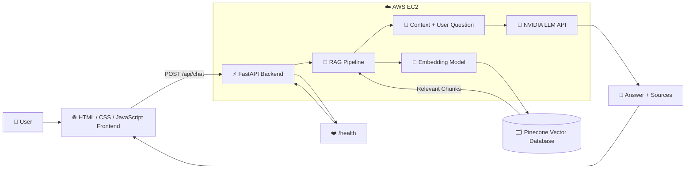
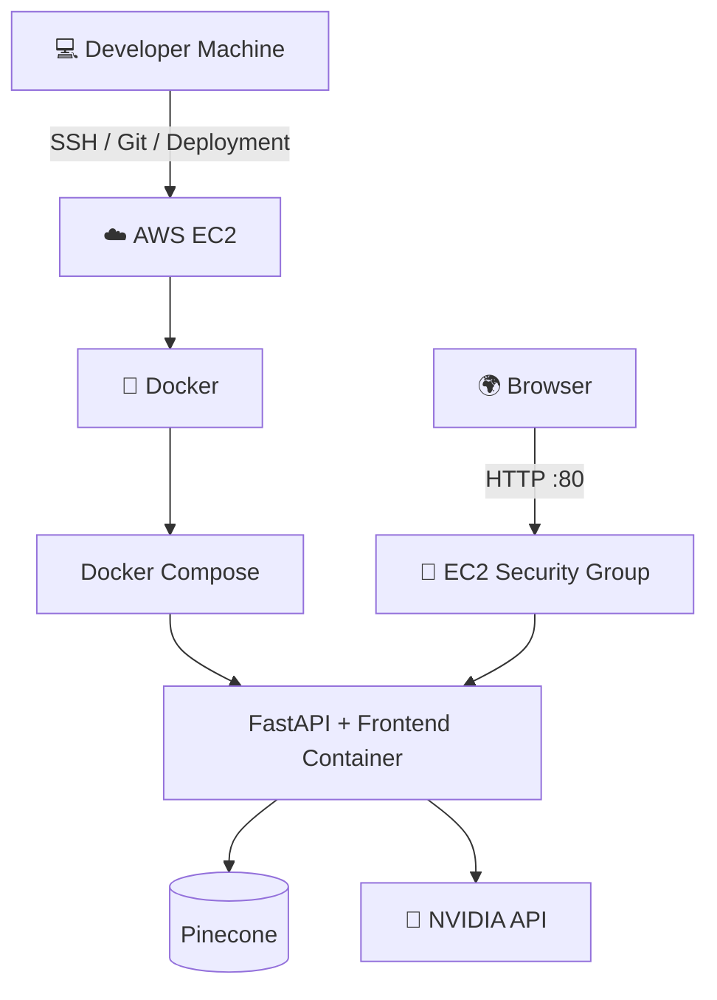
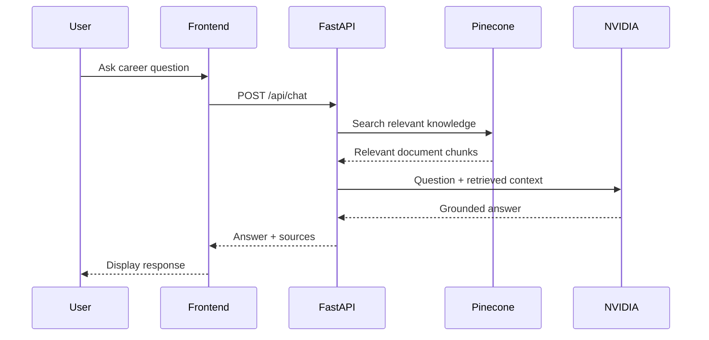

# Blockchain Career Assistant 🌐

An AI-powered **Blockchain Career Assistant** built with **RAG
(Retrieval-Augmented Generation)**. The application allows students and
beginners to ask questions about blockchain careers and receive grounded
answers from a curated knowledge base, along with source references.

The project was built as a practical experiment in combining **AI +
RAG + cloud deployment** rather than running an AI application only on a
local machine.

------------------------------------------------------------------------


------------------------------------------------------------------------

## 🚀 Project Overview 

The Blockchain Career Assistant is designed to help freshers understand
blockchain career paths, roles, skills, and learning directions.

A user can ask questions such as:

-   Which blockchain roles are suitable for freshers?
-   What skills are required for a Smart Contract Developer?
-   How can I start a career in Web3?
-   What is the difference between blockchain development roles?
-   What should I learn first as a blockchain beginner?

Instead of generating an answer from the language model alone, the
application retrieves relevant information from the project's knowledge
base and uses that context to generate the response.

### Core idea

``` text
User Question
      ↓
Frontend
      ↓
FastAPI Backend
      ↓
RAG Pipeline
      ↓
Pinecone Vector Search
      ↓
Relevant Knowledge
      ↓
NVIDIA LLM
      ↓
Answer + Sources
      ↓
Frontend
```

------------------------------------------------------------------------

## 🏗️ System Architecture

The application connects the frontend, FastAPI backend, RAG pipeline,
vector database, and NVIDIA-powered LLM into one deployable service.



### Deployment Architecture



### Request Flow



> **Note:** GitHub renders Mermaid diagrams automatically in supported
> Markdown views. If your Markdown viewer does not render Mermaid,
> the text flow diagrams in this README still explain the architecture.

------------------------------------------------------------------------

## ✨ Features

-   AI-powered blockchain career Q&A
-   Retrieval-Augmented Generation (RAG)
-   Semantic/vector search with Pinecone
-   NVIDIA API integration for LLM responses
-   Source references returned with answers
-   FastAPI backend
-   Simple HTML/CSS/JavaScript frontend
-   Dockerized application
-   Docker Compose deployment
-   AWS EC2 deployment
-   Health-check endpoint
-   Environment-based configuration
-   REST API for chat requests

------------------------------------------------------------------------

## 🧰 Tech Stack

### Frontend

-   HTML5
-   CSS3
-   JavaScript
-   Fetch API

### Backend

-   Python
-   FastAPI
-   Uvicorn

### AI / RAG

-   NVIDIA API
-   Embeddings
-   Retrieval-Augmented Generation
-   Pinecone Vector Database

### Infrastructure

-   Docker
-   Docker Compose
-   AWS EC2
-   Linux / Amazon Linux

------------------------------------------------------------------------

## 📁 Project Structure

A typical project structure is:

``` text
blockchain-career-assistant/
│
├── main.py                    # FastAPI application and API logic
├── requirements.txt            # Python dependencies
├── Dockerfile                  # Docker image configuration
├── docker-compose.yml          # Container orchestration
├── index.html                  # Frontend UI
├── .env                        # Environment variables (DO NOT COMMIT)
├── .gitignore                  # Git ignore rules
└── README.md                   # Project documentation
```

If your local project contains additional folders such as `data/`,
`docs/`, `static/`, or `templates/`, keep them in the structure
according to their actual purpose.

------------------------------------------------------------------------

## 🔐 Environment Variables

Create a `.env` file in the project root.

Example:

``` env
APP_PORT=80

NVIDIA_API_KEY=your_nvidia_api_key
PINECONE_API_KEY=your_pinecone_api_key
PINECONE_INDEX_NAME=rag
```

### Important

Never commit your real API keys to GitHub.

Add `.env` to `.gitignore`:

``` gitignore
.env
__pycache__/
*.pyc
.venv/
venv/
```

If an API key is accidentally exposed publicly, revoke it and generate a
new one.

------------------------------------------------------------------------

## 🐳 Run with Docker

### 1. Build the image

``` bash
docker compose build
```

### 2. Start the application

``` bash
docker compose up -d
```

### 3. Check running containers

``` bash
docker compose ps
```

You should see the application container running.

### 4. View logs

``` bash
docker compose logs -f
```

### 5. Stop the application

``` bash
docker compose down
```

### Rebuild after code/environment changes

``` bash
docker compose down
docker compose up -d --build
```

For a clean recreation:

``` bash
docker compose down --remove-orphans
docker compose up -d --force-recreate --build
```

------------------------------------------------------------------------

## 🩺 Health Check

The application exposes a health endpoint:

``` text
GET /health
```

Local Docker test:

``` bash
curl http://localhost/health
```

A healthy response should indicate that the important services are
available, for example:

``` json
{
  "pinecone_connected": true,
  "index_name": "rag",
  "embeddings_available": true,
  "llm_available": true,
  "rag_available": true,
  "llm_error": null
}
```

The exact response may vary depending on the application's current
implementation.

------------------------------------------------------------------------

## 💬 Chat API

The main chat endpoint is:

``` text
POST /api/chat
```

Example request:

``` bash
curl -X POST http://localhost/api/chat \
  -H "Content-Type: application/json" \
  -d '{"query":"What is blockchain?"}'
```

Example response:

``` json
{
  "answer": "A blockchain is a shared digital record book...",
  "sources": [
    "Blockchain Career Guide for Freshers (page 2)",
    "Blockchain Career Guide for Freshers (page 1)"
  ]
}
```

------------------------------------------------------------------------

## 🧠 How RAG Works in This Project

The project uses Retrieval-Augmented Generation to reduce the chance of
the model answering only from its general knowledge.

### Step 1 --- User asks a question

For example:

``` text
Which blockchain roles are suitable for freshers?
```

### Step 2 --- Question is processed

The backend receives the question through FastAPI.

### Step 3 --- Vector search

The query is converted into an embedding and searched against the
knowledge stored in Pinecone.

### Step 4 --- Relevant information is retrieved

The most relevant documents/chunks are selected.

### Step 5 --- LLM generates the answer

The retrieved context is provided to the NVIDIA-powered language model.

### Step 6 --- Response is returned

The backend sends the generated answer and source references to the
frontend.

``` text
Question
   ↓
Embedding
   ↓
Pinecone Search
   ↓
Relevant Chunks
   ↓
Context + Question
   ↓
NVIDIA LLM
   ↓
Answer + Sources
```

------------------------------------------------------------------------

## ☁️ AWS EC2 Deployment

The application can be deployed on an AWS EC2 instance.

The deployment flow used for the project is approximately:

``` text
Developer Machine
       ↓
Git / Project Files
       ↓
AWS EC2
       ↓
Docker
       ↓
Docker Compose
       ↓
FastAPI Application
       ↓
Public HTTP Port
       ↓
Browser
```

### Basic EC2 workflow

SSH into the instance:

``` bash
ssh -i "your-key.pem" ec2-user@YOUR_EC2_PUBLIC_IP
```

Navigate to the project:

``` bash
cd blockchain-career-assistant
```

Check Docker:

``` bash
docker --version
docker compose version
```

Start the application:

``` bash
docker compose up -d --build
```

Check the container:

``` bash
docker compose ps
```

Check logs:

``` bash
docker compose logs -f
```

------------------------------------------------------------------------

## 🔥 AWS Security Group

If the application is intended to be accessed from the internet, the EC2
Security Group needs an inbound rule for the port exposed by the
application.

For the current Docker configuration:

``` text
HTTP
Port: 80
Source: 0.0.0.0/0
```

This makes the HTTP service publicly reachable.

### Security note

For a production deployment, do not expose unnecessary ports. Prefer:

``` text
Internet
   ↓
HTTPS / 443
   ↓
Reverse Proxy
   ↓
Application
```

SSH on port 22 should ideally be restricted to your own IP rather than
opened to everyone.

------------------------------------------------------------------------

## 🌐 Accessing the Frontend

When the EC2 instance is running and port 80 is correctly configured,
open:

``` text
http://YOUR_EC2_PUBLIC_IP
```

For example:

``` text
http://13.210.51.67
```

Do not hard-code this IP into the application because an EC2 public IP
can change depending on the instance configuration. For production, use
a domain name and HTTPS.

------------------------------------------------------------------------

## 🔧 Useful Docker Commands

### List containers

``` bash
docker ps
```

### List all containers

``` bash
docker ps -a
```

### Enter the application container

``` bash
docker exec -it blockchain-career-assistant sh
```

### Check environment variables inside the container

``` bash
docker exec blockchain-career-assistant env
```

Avoid sharing the output publicly because it may contain secrets.

### Inspect logs

``` bash
docker logs blockchain-career-assistant
```

### Restart

``` bash
docker compose restart
```

### Stop

``` bash
docker compose down
```

------------------------------------------------------------------------

## 🧪 Testing

### Health test

``` bash
curl http://localhost/health
```

### Chat test

``` bash
curl -X POST http://localhost/api/chat \
  -H "Content-Type: application/json" \
  -d '{"query":"What is blockchain?"}'
```

### Browser test

Open:

``` text
http://YOUR_EC2_PUBLIC_IP
```

Then submit questions through the frontend.

------------------------------------------------------------------------

## 🔒 Security Considerations

This project is currently a learning/development deployment. Before
using it as a production service, consider adding:

-   HTTPS/TLS
-   Domain name
-   Nginx or another reverse proxy
-   Authentication
-   API rate limiting
-   Request validation
-   CORS configuration
-   Secure secret management
-   Monitoring and logging
-   Backup/recovery strategy
-   Restricted SSH access
-   Firewall rules
-   Production database if required
-   Usage/cost monitoring for external AI APIs

Most importantly:

**Never upload `.env` or API keys to GitHub.**

------------------------------------------------------------------------

## 📈 Future Improvements

The next direction for this project is to explore **Cloud + AI** more
deeply.

Possible improvements:

### AI

-   Better retrieval and chunking
-   Query rewriting
-   Reranking
-   Conversation memory
-   Multiple knowledge bases
-   Evaluation of RAG accuracy
-   Hallucination detection
-   Streaming responses

### Cloud

-   Domain + HTTPS
-   Nginx reverse proxy
-   CI/CD with GitHub Actions
-   Container registry
-   Automated deployments
-   Cloud monitoring
-   Centralized logging
-   Autoscaling
-   Load balancing

### Product

-   User authentication
-   Saved conversations
-   Personalized career roadmaps
-   Resume analysis
-   Skill-gap analysis
-   Job-role recommendations
-   Learning-plan generation
-   Admin dashboard
-   Analytics
    
------------------------------------------------------------------------

## 🎯 Why I Built This

The goal wasn't only to make another chatbot.

I wanted to understand what happens when an AI application moves from:

``` text
"My laptop"
```

to:

``` text
"An actual cloud server"
```

That meant learning about APIs, environment variables, Docker,
networking, cloud infrastructure, RAG, vector databases, deployment, and
debugging.

The biggest lesson from this project:

> Building the AI feature is only part of the problem. Making the whole
> system reliable and deployable is another skill.

This project is the beginning of my exploration into **Cloud + AI
engineering**.

------------------------------------------------------------------------

## 🤝 Contributing

Contributions, suggestions, and improvements are welcome.

A basic contribution workflow:

``` bash
git clone YOUR_REPOSITORY_URL
cd blockchain-career-assistant

git checkout -b feature/your-feature

# Make your changes

git add .
git commit -m "Add your feature"
git push origin feature/your-feature
```

Then open a Pull Request.

------------------------------------------------------------------------

## 📄 License

Add the project's chosen license here.

For example:

``` text
MIT License
```

If this repository contains third-party documents or datasets, make sure
their licenses and attribution requirements are respected.

------------------------------------------------------------------------

## 👨‍💻 Author

**Shivam Prajapati**

Built as a hands-on project exploring:

**AI × RAG × Cloud × Docker × AWS**

------------------------------------------------------------------------

## ⭐ If You Found This Useful

If this project helped you learn something about AI, RAG, Docker, or
cloud deployment, consider giving the repository a ⭐.
